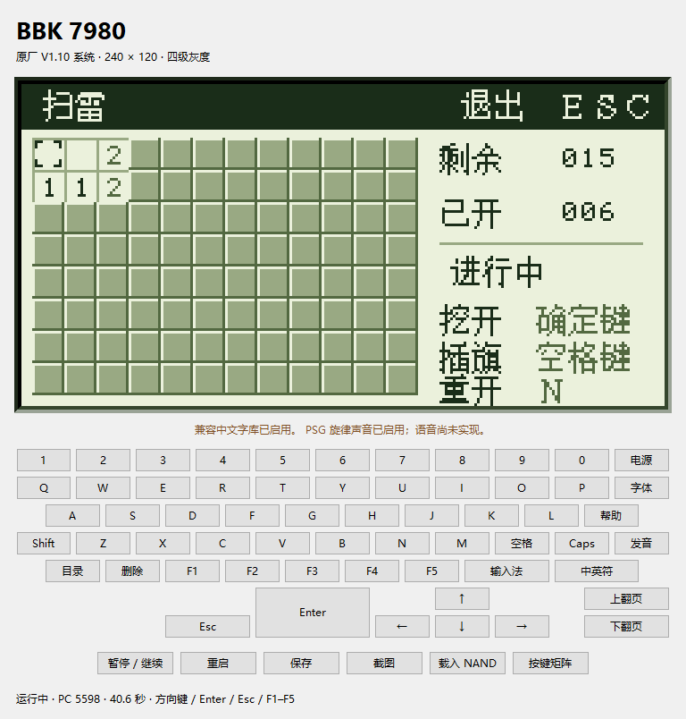

# 步步高 7980 模拟器

在 Windows 和 macOS 上运行朗文 7980 的 V1.10 系统。模拟器包含 65C02 指令、存储分页、128 KiB 外置 SRAM、定时器、中断、240 × 120 四级灰度 LCD、按键矩阵、UART 和虚拟 NAND。面板按 7980 真机照片排布，四方向键已在原厂工具菜单中逐一核对。



## 下载与运行

### 下载模拟器和系统镜像

1. 下载 [BBK7980 模拟器（Windows x64）](https://github.com/HelloClyde/BBK7980-emulator/releases/download/v0.6.3/BBK7980-emulator-0.6.3-win64.zip)，完整解压。
2. 下载 [V1.10 系统镜像](https://github.com/HelloClyde/BBK7980-emulator/releases/download/v0.6.3/BBK7980-V1.10-runtime.zip)，把压缩包里的整个 `runtime` 文件夹解压到 `BBK7980.exe` 旁边。镜像包含 V1.10 原厂固件、预装 NAND、兼容字库和扫雷。
3. 双击 `BBK7980.exe`，模拟器会自动读取该目录并进入系统。

```text
BBK7980/
├── BBK7980.exe
├── _internal/
└── runtime/
    ├── syscode.bin
    ├── installed-nand.bin.z
    └── installed-manifest.json
```

### macOS（Apple Silicon / Intel）

在 [Releases](https://github.com/HelloClyde/BBK7980-emulator/releases) 选择与 Mac 对应的 ZIP（Apple Silicon 用 `macos-arm64`，Intel 用 `macos-x86_64`），解压后打开 `BBK7980.app`。每个版本以该 Release 实际列出的资产为准。预览包使用临时签名，系统可能要求在「隐私与安全性」中单独批准打开。最低支持的 macOS 版本以实际验证结果为准。

macOS 应用默认使用 `~/Library/Application Support/BBK7980/runtime`。首次启动可选择官网升级包，也可先将同版本的独立系统镜像解压到该路径。移植版旧存档可用同一目录直接读取。源码运行仍默认使用项目下的 `runtime/`。指定 `--runtime PATH` 可覆盖 `BBK7980_RUNTIME` 和默认目录，例如：

```sh
./BBK7980.app/Contents/MacOS/BBK7980 --runtime ~/bbk-runtime
```

文件和模拟器菜单支持 ⌘S 保存、⇧⌘S 截图、⌘P 暂停、⌘R 重启和 ⌘W 关闭。Command 与 Option 组合键留给宿主。

### 从官网升级包自行生成镜像

同一个模拟器也可以从官网升级包初始化。先[从步步高官网下载朗文 7980 V1.10 升级包](https://down.eebbk.net/xzzx/7980/1/7980sj.exe)，保存为 `7980sj.exe`。首次启动模拟器时，在文件选择窗口选中这个升级包。模拟器会生成 `runtime/`，校验完成后自动进入系统。

官网升级包的 SHA-256 为 `b9c4aa62cd9517859930620cdce5f7c6027120777926bb49e56989bb4e8d145c`。模拟器和系统镜像的校验文件见 [GitHub Release](https://github.com/HelloClyde/BBK7980-emulator/releases/tag/v0.6.3)。

## 键盘和存档

在主界面按 Page Up / Page Down 翻页，按应用图标旁的数字打开应用。也可以用方向键选择、Enter 确认、Esc 返回。进入「娱乐」可打开《扫雷》，用方向键移动、Enter 翻开格子、空格插旗、Esc 退出。

| 电脑按键 | 模拟器按键 |
| --- | --- |
| 方向键、Enter、Esc | 四方向、确认、退出 |
| Page Up / Page Down | 上翻页 / 下翻页 |
| Home | 目录 |
| Backspace / Delete | 删除 |
| F1–F5 / F6 | F1–F5 / 帮助 |
| Caps Lock / Shift | 大小写 / Shift |

数字、字母、空格可直接输入，电源、字体、帮助、输入法和中英符也可以在面板上点选。菜单中的「载入 NAND」可打开同一模拟器格式的 NAND 文件。

`runtime/` 保存固件和基准镜像。点「保存」或正常退出会把用户镜像写入 `runtime/data/nand.bin`。换目录或升级模拟器时，可把旧版的整个 `runtime/` 一并复制过去，以保留系统和存档。如果旧版把存档放在 `data/nand.bin`，备份后将该文件复制到新版的 `runtime/data/nand.bin`。

## 单个文件的导入和导出

- 点「导入文件」，在电脑的文件选择器里选中一个或多个普通数据文件或 7980 SDK 生成的 `BJBBK.110` 应用传输包。普通数据文件沿用文件名，应用沿用包内的文件名和分类。所有文件读回校验通过后统一保存，同名机内文件会被替换。
- 点「导出文件」，点击选中列表中的一个或多个机内文件，再选择电脑上的保存目录。文件按原名保存，遇到同名文件会先确认。导出的是机内文件原始内容，应用的 PC 传输包头需要使用 SDK 另行生成。
- 两项操作都通过原厂「电脑联机」，会重启模拟器。请先在当前应用里保存进度。

## TXT 转 EBK

使用 Python 3.11 运行源码目录下的 `txt_to_ebk.py`（便携包内位于 `source/`）。转换无需模拟器动态库或固件。转换后在模拟器中点「导入文件」，再到 V1.10 的书架打开。

```sh
python3 txt_to_ebk.py 小说.txt 小说.ebk
```

默认识别 UTF-8、带 BOM 的 Unicode 和 GB18030，可用 `--encoding` 显式指定。正文必须能编码为 GBK，文件名必须用小写 `.ebk`，含扩展名最多 63 个 GBK 字节。同名输出需显式传入 `--force`。

## 从源码运行

### Windows

需要 Windows x64、Python 3.11 和 MSYS2 UCRT64 GCC。将 UCRT64 的 `bin` 加入 PATH，然后在项目根目录运行：

```powershell
python -m pip install -r requirements.txt
python build.py
python tools/build_demo.py
python app.py
```

`tools/build_demo.py` 从固定的 SDK v1.1.1 发行资产构建扫雷，核对资产的 SHA-256，在临时副本里修正 SDK 的四个方向键编号，并让扫雷使用这些键值。也可用 `--sdk-archive PATH` 指定同一个已下载的 SDK ZIP。省略这一步时，首次导入只安装官网包和兼容字库。

```powershell
python prepare.py C:\path\to\7980sj.exe
python -m unittest discover -s tests -v
python -m pip install -r requirements-build.txt
python package.py
python tools/verify_release.py dist
```

### macOS

需要带 Tk 的 Python 3.11 和 Xcode Command Line Tools。在本机按当前 Python 架构构建：

```sh
python3 -m pip install -r requirements-build.txt
python3 build.py
python3 -m unittest discover -s tests -v
python3 app.py
python3 package.py
```

打包输出位于 `dist/`。从官网包自行初始化时，macOS 构建默认只安装原厂系统和兼容字库。需要 SDK 扫雷可使用独立系统镜像。Windows x64 与两种 macOS 架构共用一个 `VERSION` 和发行标签。

未导入官网包时，测试使用合成 ROM 检查 CPU、中断及 NAND，原厂系统的集成测试会跳过。安装后的测试覆盖格式化、串口往返、菜单、按键、字库读取。GitHub Actions 从公开源码构建并检查便携包。

## 已知限制和许可

兼容字库基于 GNU Unifont，字形与原厂字库有差别。PSG 方波旋律可输出，原机语音尚未实现，中文输入法仍有兼容问题。RAM 和部分外设的参数是模拟模型，真机容量和完整电气时序仍待确认。更多实现细节见 [硬件研究](hardware.md)。

模拟器采用 [GPL-3.0](COPYING)。感谢 9288 / GAM4980 和 Unifont 的贡献者，见 [第三方组件与致谢](THIRD_PARTY.md)。
